<!--- ═══════════════════════════════════════════════════════════ --->
<!---                        HEADER                               --->
<!--- ═══════════════════════════════════════════════════════════ --->

<picture>
  <source media="(prefers-color-scheme: dark)" srcset="assets/header-dark.svg">
  <source media="(prefers-color-scheme: light)" srcset="assets/header-light.svg">
  
</picture>

<!--- ═══════════════════════════════════════════════════════════ --->
<!---                        ABOUT                                --->
<!--- ═══════════════════════════════════════════════════════════ --->

<p align="center">
I'm a Software Engineer at <a href="https://www.cefalo.com/"><b>Cefalo Bangladesh</b></a>, building full-stack web applications and mobile apps. As a researcher at <b>BARTA Research Lab</b>, <a href="https://iit.du.ac.bd/">IIT, University of Dhaka</a>, I work on LLMs and AI agents, with a focus on LLM efficiency, context management, and adaptive inference.
</p>

<table width="100%" border="0" cellspacing="0" cellpadding="0">
<tr>
<td width="55%" valign="middle">

```yaml
web       : React · Next.js · Express · TypeScript
mobile    : Flutter · Dart · Firebase
research  : LLM efficiency · context management · adaptive inference
workflow  : agentic development · production features

# beyond engineering
curious   : history · philosophy
hobbies   : reading books · learning new things
```

</td>
<td width="45%" align="center" valign="middle">

</td>
</tr>
</table>

<p align="center">
  <a href="https://linkedin.com/in/ummekulsumtumpa"></a>
  <a href="https://scholar.google.com/citations?user=3iF7aUQAAAAJ&hl=en"></a>
  <a href="https://leetcode.com/iampilgrim_"></a>
  <a href="mailto:bsse1307@iit.du.ac.bd"></a>
  <a href="https://hits.sh/github.com/UmmeKulsumTumpa/"></a>
</p>

<!--- ═══════════════════════════════════════════════════════════ --->
<!---                        WHAT I DO                            --->
<!--- ═══════════════════════════════════════════════════════════ --->

## What I Do

<table width="100%" border="0">
<tr>
<td align="center" width="25%">

<br/><b>Full-Stack Web</b>
<br/><sub>React · Next.js · Express</sub>
</td>
<td align="center" width="25%">

<br/><b>Research</b>
<br/><sub>LLMs · NLP · AI agents</sub>
</td>
<td align="center" width="25%">

<br/><b>Mobile</b>
<br/><sub>Flutter · Dart · Firebase</sub>
</td>
<td align="center" width="25%">

<br/><b>Problem Solving</b>
<br/><sub>Real-world product &amp; research problems</sub>
</td>
</tr>
</table>

<!--- ═══════════════════════════════════════════════════════════ --->
<!---                        TECH IN MOTION                       --->
<!--- ═══════════════════════════════════════════════════════════ --->

## Tech in Motion

<picture>
  <source media="(prefers-color-scheme: dark)" srcset="assets/tech-dark.svg">
  <source media="(prefers-color-scheme: light)" srcset="assets/tech-light.svg">
  
</picture>

<!--- ═══════════════════════════════════════════════════════════ --->
<!---                        GITHUB STATS                         --->
<!--- ═══════════════════════════════════════════════════════════ --->

## GitHub Stats

<table width="100%" border="0">
<tr>
<td width="55%" align="center">
<picture>
  <source media="(prefers-color-scheme: dark)" srcset="https://github-readme-stats.vercel.app/api?username=UmmeKulsumTumpa&show_icons=true&hide_border=true&bg_color=0d1117&title_color=a78bfa&icon_color=a78bfa&text_color=c9d1d9">
  
</picture>
</td>
<td width="45%" align="center">
<picture>
  <source media="(prefers-color-scheme: dark)" srcset="https://github-readme-stats.vercel.app/api/top-langs/?username=UmmeKulsumTumpa&layout=compact&hide_border=true&bg_color=0d1117&title_color=a78bfa&text_color=c9d1d9">
  
</picture>
</td>
</tr>
</table>

<!--- ═══════════════════════════════════════════════════════════ --->
<!---                        FOOTER                               --->
<!--- ═══════════════════════════════════════════════════════════ --->

<picture>
  <source media="(prefers-color-scheme: dark)" srcset="assets/footer-dark.svg">
  <source media="(prefers-color-scheme: light)" srcset="assets/footer-light.svg">
  
</picture>
